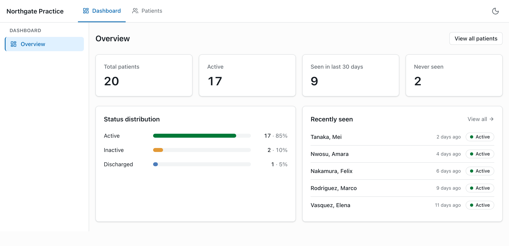
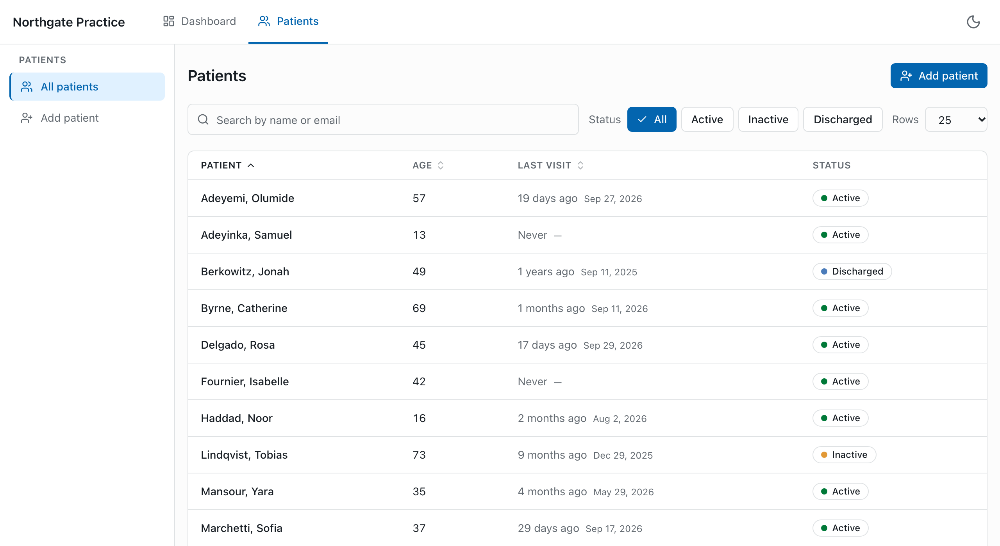
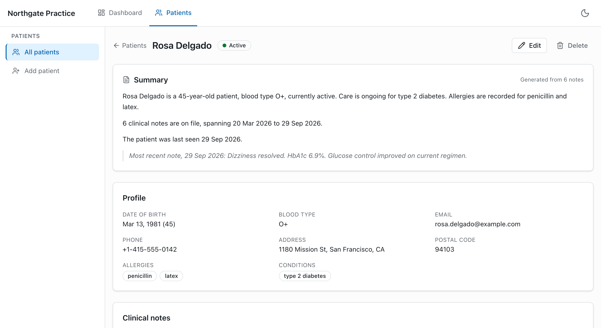
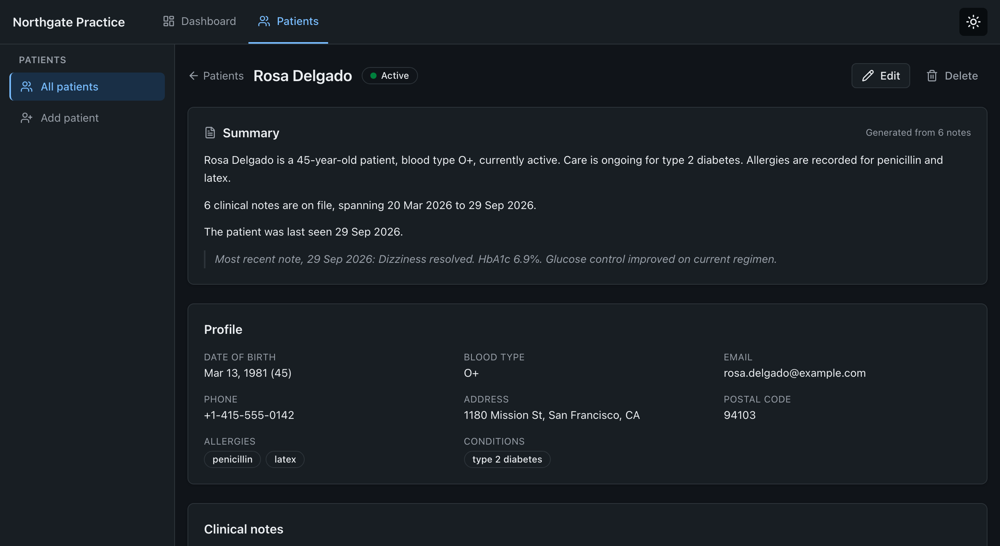

# Healthcare Dashboard

A patient management dashboard for a medical practice: React + TypeScript frontend,
FastAPI backend, PostgreSQL.

---

## Table of contents

- [Quick start](#quick-start)
- [What this does](#what-this-does)
- [Architecture at a glance](#architecture-at-a-glance)
- [Tech stack and why](#tech-stack-and-why)
- [Configuration](#configuration)
- [Local development without Docker](#local-development-without-docker)
- [API](#api)
- [Project structure](#project-structure)
- [Testing](#testing)
- [Quality gates](#quality-gates)
- [Performance](#performance)
- [Architecture decisions](#architecture-decisions)
- [What I would do next](#what-i-would-do-next)

---

## Quick start

Requires Docker with Compose v2. Nothing else: no local Python, Node or Postgres.

```bash
cp .env.example .env     # safe local defaults, no edits needed
make up                  # or: docker compose up --build
```

| Service  | URL                             |
| -------- | ------------------------------- |
| Frontend | http://localhost:5173           |
| API      | http://localhost:8000           |
| API docs | http://localhost:8000/docs      |
| Health   | http://localhost:8000/health    |
| Readiness| http://localhost:8000/health/ready |
| Postgres | localhost:5432                  |

The database is migrated and seeded with 20 patients (plus clinical notes) on
first start. `make down` stops it; `make reset` drops the volume and starts clean.

```bash
make help      # every available target
make logs      # tail all services
make test      # backend + frontend test suites
make lint      # ruff, mypy, eslint, tsc
```

---

## What this does

- Browse, search, sort and page a patient list that stays responsive at 100+ rows,
  with a rows-per-page control (25/50/100)
- View a patient profile with their clinical notes
- Add and delete clinical notes
- Read a generated, human-readable patient summary built from profile + notes
- Create and edit patients with validation on both the client and the server
- Light/dark theme, responsive down to small screens

---

## Screens

**Dashboard** — counts from a single aggregate query, plus the status breakdown.



**Patient list** — search, status filters, sortable columns and paging, all held
in the URL so a view can be shared or reloaded.



**Patient detail** — the generated summary, the record it was built from, and
the clinical notes.



**Dark theme** — the same page with one token set swapped.



## Architecture at a glance

```
┌──────────────────────────────┐        ┌──────────────────────────────────────┐
│  Browser (React SPA)         │        │  FastAPI (ASGI, async)               │
│                              │        │                                      │
│  pages ─ features ─ ui       │        │  api/v1  ──► routes: HTTP only       │
│        │                     │ HTTP   │     │                                │
│  TanStack Query (server      │ JSON   │  services ──► use cases, invariants  │
│  state cache)  ──────────────┼───────►│     │                                │
│        │                     │        │  repositories ──► SQL, no business   │
│  Zustand (UI-only state)     │        │     │            rules               │
│        │                     │        │  models ──► SQLAlchemy ORM           │
│  lib/api/client (one seam)   │        │                                      │
└──────────────────────────────┘        └──────────────────┬───────────────────┘
                                                           │ asyncpg
                                                  ┌────────▼────────┐
                                                  │   PostgreSQL    │
                                                  │  (Alembic DDL)  │
                                                  └─────────────────┘
```

Two rules hold this together:

1. **Dependencies point inward, one layer at a time.** A route may call a service;
   a service may call a repository. Nothing calls backwards, and nothing skips a
   layer. The practical payoff: services are unit-testable with no HTTP and no SQL.
2. **Server state and UI state are different things.** Anything the server owns
   lives in the TanStack Query cache and is never copied into a store. Only
   genuinely client-side state (theme, sidebar) lives in Zustand. This is the
   single biggest source of bugs in dashboards of this shape, so it is a rule,
   not a preference. See [ADR 0002](docs/adr/0002-frontend-stack.md).

Full detail: [docs/ARCHITECTURE.md](docs/ARCHITECTURE.md).

---

## Tech stack and why

### Backend

| Choice                     | Why this and not the alternative                                                                                              |
| -------------------------- | ----------------------------------------------------------------------------------------------------------------------------- |
| FastAPI (async)            | Required. Async end-to-end because this workload is I/O-bound; OpenAPI comes free from the Pydantic models.                    |
| SQLAlchemy 2.0 + asyncpg   | Typed ORM with a real async driver. Core-style `select()` keeps the heavy list query explicit instead of hidden behind magic.   |
| Alembic                    | Versioned, reviewable DDL. An `init.sql` cannot express a schema change after the first release.                               |
| Pydantic v2 + pydantic-settings | One validation boundary for request bodies and for environment config, so bad input and bad config both fail loudly and early. |
| structlog                  | Structured JSON logs with a `request_id` bound in, so a request is greppable across layers.                                   |

### Frontend

| Choice                        | Why this and not the alternative                                                                                                  |
| ----------------------------- | ---------------------------------------------------------------------------------------------------------------------------------- |
| Vite + React 19 + TypeScript  | Required, strict mode on.                                                                                                          |
| TanStack Query                | Server cache, not a store: dedupes requests, keeps previous page during paging, and makes invalidation explicit. Redux for server data would mean hand-rolling all of that. |
| Zustand (small)               | UI-only state. Tiny, no provider ceremony, no reducers for a boolean.                                                              |
| React Router                  | Route-based code splitting, and the URL as the source of truth for list filters.                                                   |
| Tailwind v4 + headless primitives | Tokens in CSS variables mean theming is one token swap, not duplicated class lists. Primitives are local files, so no fighting a component library's opinions. |
| react-hook-form + Zod         | Uncontrolled inputs (fewer re-renders) and one schema that produces both runtime validation and the TypeScript type.               |
| lucide-react                  | Icons, imported per icon so only the ones used are bundled.                                                                        |
| Vitest + RTL + Playwright     | Component tests against the real provider tree, E2E against the composed stack.                                                    |

Exact versions are pinned in `frontend/package.json` and `backend/pyproject.toml`.

---

## Configuration

Copy `.env.example` to `.env`. Defaults are development-safe; nothing here is a
real secret.

| Variable              | Default                   | Used by  | Notes                                                             |
| --------------------- | ------------------------- | -------- | ----------------------------------------------------------------- |
| `POSTGRES_USER`       | `postgres`                | db, api  |                                                                   |
| `POSTGRES_PASSWORD`   | `postgres`                | db, api  | Local only.                                                       |
| `POSTGRES_DB`         | `healthcare`              | db, api  |                                                                   |
| `POSTGRES_HOST`       | `localhost`               | api      | Compose overrides this to `db` inside the network.                |
| `POSTGRES_PORT`       | `5432`                    | db, api  |                                                                   |
| `DATABASE_URL`        | derived                   | api      | Overrides the parts above if set.                                 |
| `APP_ENV`             | `development`             | api      | `development` \| `production`; switches log format and `/docs`.   |
| `LOG_LEVEL`           | `INFO`                    | api      |                                                                   |
| `CORS_ORIGINS`        | `http://localhost:5173`   | api      | Comma-separated.                                                  |
| `SEED_ON_STARTUP`     | `true`                    | api      | Idempotent; safe to leave on locally.                             |
| `VITE_API_BASE_URL`   | _(empty)_                 | web      | Empty = same origin; `/api` is proxied. Baked in at build time.   |

The app reads config **only** through `backend/app/core/config.py` and
`frontend/src/lib/config/env.ts`. No `os.environ` or `import.meta.env` anywhere else.

---

### After changing dependencies

Dependencies live inside the images, so a new package needs a rebuild of that
service:

```bash
npm install <package> --prefix frontend   # or edit backend/pyproject.toml
docker compose up -d --build web          # or: --build api migrate
```

Editing source does not need a rebuild. Both services mount their source and
reload automatically.

## Local development without Docker

<details>
<summary>Backend</summary>

```bash
cd backend
python -m venv .venv && source .venv/bin/activate
pip install -e ".[dev]"
alembic upgrade head
uvicorn app.main:app --reload --port 8000
```

Needs a reachable Postgres. `docker compose up db` is the easy way.
</details>

<details>
<summary>Frontend</summary>

```bash
cd frontend
npm install
npm run dev
```
</details>

---

## API

Base path `/api/v1`, except `/health`. Interactive docs at `/docs`.

| Method   | Path                              | Purpose                               |
| -------- | --------------------------------- | ------------------------------------- |
| `GET`    | `/health`                         | Liveness. Returns `{"status": "ok"}`  |
| `GET`    | `/health/ready`                   | Readiness. 503 if the database is down |
| `GET`    | `/patients`                       | List: paginate, search, filter, sort  |
| `GET`    | `/patients/stats`                 | Dashboard counts in one aggregate     |
| `POST`   | `/patients`                       | Create                                |
| `GET`    | `/patients/{id}`                  | Fetch one                             |
| `PUT`    | `/patients/{id}`                  | Update                                |
| `DELETE` | `/patients/{id}`                  | Delete                                |
| `GET`    | `/patients/{id}/notes`            | List notes                            |
| `POST`   | `/patients/{id}/notes`            | Add a note                            |
| `DELETE` | `/patients/{id}/notes/{note_id}`  | Delete a note                         |
| `GET`    | `/patients/{id}/summary`          | Generated summary                     |

Every error shares one body shape, so the client has exactly one error path to
handle:

```json
{
  "type": "/errors/validation-error",
  "title": "Validation failed",
  "status": 422,
  "detail": "1 field is invalid.",
  "instance": "/api/v1/patients",
  "request_id": "01JB2…",
  "errors": [{ "field": "date_of_birth", "message": "must be in the past" }]
}
```

Request/response examples, query parameters and the full status-code table:
[docs/API.md](docs/API.md). Schema: [docs/DATA_MODEL.md](docs/DATA_MODEL.md).

---

## Project structure

```
healthcare-dashboard/
├── backend/
│   ├── app/
│   │   ├── api/v1/          # HTTP layer: routes, status codes, response models
│   │   ├── core/            # config, logging, errors, middleware, pagination
│   │   ├── db/              # engine, session, Base, seed
│   │   ├── models/          # SQLAlchemy ORM
│   │   ├── repositories/    # all SQL lives here
│   │   ├── schemas/         # Pydantic request/response contracts
│   │   └── services/        # use cases and business rules
│   ├── migrations/          # Alembic
│   └── tests/               # unit + integration
├── frontend/
│   ├── src/
│   │   ├── app/             # providers, router, query client
│   │   ├── components/      # layout, ui primitives, feedback
│   │   ├── features/        # patients, notes, dashboard (vertical slices)
│   │   ├── lib/             # api client, config, utils
│   │   └── store/           # UI-only state
│   └── e2e/                 # Playwright
├── docs/                    # architecture, API, data model, ADRs
├── docker-compose.yml       # production-shaped
├── docker-compose.override.yml  # dev: hot reload both apps
└── Makefile
```

A **feature** folder owns its own `api/`, `components/`, `hooks/`, `schemas/` and
`pages/`. Code is grouped by what it is about, not by what kind of file it is, so
a change to patients touches one directory.

---

## Testing

```bash
make test                               # everything
make test-backend                       # pytest
make test-frontend                      # vitest
make test-e2e                           # playwright against the composed stack
```

| Layer                | Tool                 | What it is responsible for proving                                        |
| -------------------- | -------------------- | ------------------------------------------------------------------------- |
| Backend unit         | pytest               | Summary generation and pagination rules, no DB or HTTP                    |
| Backend integration  | pytest + httpx       | Real routes against real Postgres: status codes, validation, paging       |
| Frontend component   | Vitest + RTL         | Form validation, server-error mapping, non-blocking search                |
| E2E                  | Playwright           | The main journey, plus an axe accessibility scan                          |

Integration tests use a real database on purpose. Mocking the DB would pass while
the SQL is wrong, which is the one thing those tests exist to catch.

**55 backend tests** (97% coverage of `app/`), **37 frontend tests**, **22 end-to-end
tests**. Integration tests create and migrate a
throwaway `healthcare_test` database, so `make up` (or at least the `db` service)
must be running first.

---

## Quality gates

Run locally by `make lint`, and in CI on every push
([`.github/workflows/ci.yml`](.github/workflows/ci.yml)):

- `ruff` lint + format check, `mypy` (strict) on `backend/app`
- `eslint` with `--max-warnings=0`, `tsc --noEmit` on the frontend
- both test suites
- both Docker images build

CI mirrors the Makefile targets, so "works locally" and "passes CI" cannot drift.

---

## Performance

Measured, not asserted: 5,027 patients loaded with `backend/scripts/bulk_seed.py`,
API numbers are the mean of 20 requests, browser numbers come from
`frontend/e2e/performance.spec.ts`.

| Request                                   | Mean   | Max    |
| ----------------------------------------- | ------ | ------ |
| `page=1&page_size=25`                     | 16.3ms | 41.0ms |
| `page=1&page_size=100`                    | 15.9ms | 23.0ms |
| `page=200&page_size=25` (deep offset)     | 17.9ms | 28.4ms |
| `q=ro` (substring search)                 | 14.4ms | 22.0ms |
| `q=del&status=active&sort=-last_visit_at` | 12.4ms | 17.5ms |
| `/patients/stats`                         | 8.6ms  | 10.2ms |

| Page size | Time to rendered rows | DOM nodes |
| --------- | --------------------- | --------- |
| 25        | 418ms                 | 298       |
| 50        | 294ms                 | 523       |
| 100       | 346ms                 | 973       |

Typing seven characters into search takes **42ms** with a request in flight.

**Row virtualization was measured and declined.** The API caps `page_size` at
100, so the number of rendered rows is bounded by the contract and there is
nothing to virtualize. See [ADR 0007](docs/adr/0007-measured-performance.md).

What the numbers do support:

- **One query per list request.** Filter + sort + page + total count in a single
  statement; detail fetches eager-load notes, so no N+1.
- **Indexed to match the query.** See [ADR 0004](docs/adr/0004-list-query-contract.md).
- **Keyset-ready pagination contract.** Offset paging now, but the response
  envelope does not promise offsets, so it can move to keyset without a breaking change.
- **Non-blocking search.** Debounced input plus `useDeferredValue`: keystrokes
  never wait on a render or a request.
- **Route-level code splitting.** Each page is its own chunk; the dashboard
  chart is plain CSS, so no charting library is shipped at all.
- **Targeted memoization.** Memoized rows and stable callbacks, applied where a
  profile showed re-renders rather than everywhere by reflex.


---

## Architecture decisions

Short ADRs, one decision each, including what was rejected and why:

| ADR                                                           | Decision                                       |
| ------------------------------------------------------------- | ---------------------------------------------- |
| [0001](docs/adr/0001-record-architecture-decisions.md)        | Record decisions in ADRs                       |
| [0002](docs/adr/0002-frontend-stack.md)                       | Frontend stack and the state-ownership split   |
| [0003](docs/adr/0003-backend-layering.md)                     | Route → service → repository layering          |
| [0004](docs/adr/0004-list-query-contract.md)                  | Pagination, filtering and sorting contract     |
| [0005](docs/adr/0005-error-contract.md)                       | One error body shape, and validation on both sides |
| [0006](docs/adr/0006-patient-summary-generation.md)           | Deterministic template summaries               |
| [0007](docs/adr/0007-measured-performance.md)                | Performance measured; virtualization declined  |

---

## What I would do next

What a production deployment of this would need next, and why each is out of scope today:

- **Auth and audit.** This is PHI. Real deployment needs authentication,
  role-based access, and an append-only audit log of who read or changed what.
  The layering here leaves one obvious seam for it (`api/deps.py`).
- **Soft delete.** Clinical records should be archived, not `DELETE`d. The models
  carry timestamps ready for a `deleted_at` column; today's delete is a hard one.
- **Keyset pagination** once the dataset is large enough for deep offsets to hurt.
- **Rate limiting and payload caps** at the edge.
- **OpenAPI-generated client** so frontend types come from the backend schema
  instead of being mirrored by hand (today's drift risk, noted in ADR 0005).
- **Observability**: OpenTelemetry traces across the request, not just logs.
